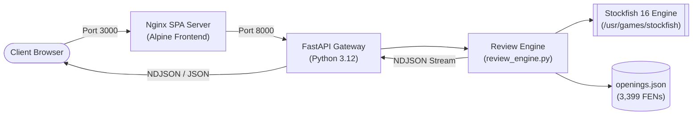

<div align="center">

# ♟️ ChessReview

### Production-Grade Full-Stack Chess Game Analysis Platform Powered by Stockfish & FastAPI

[](https://github.com/ChessReview/ChessReview/actions/workflows/ci.yml)
[](https://www.python.org/)
[](https://fastapi.tiangolo.com)
[](https://react.dev)
[](https://www.docker.com/)
[](LICENSE)
[](https://github.com/psf/black)
[](https://github.com/astral-sh/ruff)

<p align="center">
  <a href="#-quick-start">Quick Start</a> •
  <a href="#-features">Features</a> •
  <a href="#-architecture">Architecture</a> •
  <a href="#-api-documentation">API Docs</a> •
  <a href="#-chess-analysis-engine">Engine Math</a> •
  <a href="#-contributing">Contributing</a>
</p>

</div>

---

## 📖 Overview

**ChessReview** is an open-source, full-stack chess analytics platform inspired by Chess.com's game review engine. It dissects full PGN games ply-by-ply using **Stockfish 16**, classifies moves into standard taxonomic tiers (Brilliant, Great, Best, Inaccuracy, Mistake, Blunder), computes centipawn loss curves and accuracy metrics, matches ECO openings, and streams live progress to an interactive React frontend via NDJSON.

Designed with enterprise software engineering standards, ChessReview features multi-stage Docker containerization, comprehensive health checks, structured logging, a complete automated test suite, pre-commit quality hooks, and GitHub Actions CI/CD pipelines.

---
---

## ✨ Features

* **Multi-Tier Move Classification:** Detects 11 distinct move categories including **Brilliant sacrifices**, **Missed Wins**, **Missed Mates**, and standard centipawn tiers.
* **Real-Time Streaming Engine:** Emits real-time NDJSON progress events (`{"type": "progress", "ply": 14, "percent": 42.5}`) so users see instant feedback.
* **Dynamic Evaluation Graph:** Interactive ply-by-ply centipawn trajectory tracking positional advantage swings.
* **ECO Opening Detection:** Automatic identification of 3,300+ opening variations from FEN positions.
* **Chess.com Archives Integration:** Direct one-click import of public player game archives.
* **Multi-Stage Dockerization:** Hardened, unprivileged containers for production deployment with non-root security.
* **FastAPI Observability:** Enterprise logging, request timing middleware, and `/health` probe endpoints.
* **Cross-Platform Reproducibility:** Automated Make command center and strict pre-commit linters (Ruff, Black, isort, Flake8).

---

## 🏛️ Architecture & System Design



For complete architectural specifications, sequence diagrams, and container topology, refer to [docs/ARCHITECTURE.md](docs/ARCHITECTURE.md).

---

## 🛠️ Tech Stack

| Domain | Technologies |
| :--- | :--- |
| **Frontend** | React 18, Vite, Tailwind CSS, Recharts, React-Chessboard, Chess.js |
| **Backend** | FastAPI, Python 3.12, Uvicorn, Pydantic, python-chess |
| **Chess Engine** | Stockfish 16 (UCI Protocol), ECO Opening Database |
| **DevOps & Infra** | Docker, Docker Compose, Nginx, GitHub Actions, Linux |
| **Quality & Tests** | Pytest, Pytest-Cov, Ruff, Black, isort, Flake8, Pre-commit |

---

## 📁 Repository Structure

```
ChessReview/
├── .github/                      # CI/CD Workflows, Issue & PR templates
│   ├── ISSUE_TEMPLATE/
│   ├── workflows/ci.yml          # GitHub Actions pipeline
│   └── PULL_REQUEST_TEMPLATE.md
├── backend/                      # FastAPI Python Application
│   ├── engine/                   # Stockfish local binary cache
│   ├── games/sample.pgn          # Sample demonstration game
│   ├── opening_books/            # Opening theory database (openings.json)
│   ├── config.py                 # Centralized environment settings
│   ├── Dockerfile                # Multi-stage backend container
│   ├── live_analysis.py          # Single-position FEN evaluation
│   ├── logger.py                 # Structured logging utility
│   ├── main.py                   # FastAPI routers and health checks
│   └── review_engine.py          # Stockfish analysis & move classification
├── docs/                         # Documentation & Specifications
│   ├── API.md                    # REST API endpoint reference
│   ├── ARCHITECTURE.md           # Architecture diagrams & sequence flows
│   └── CHESS_ENGINE.md           # Centipawn & classification math
├── frontend/                     # React/Vite SPA Application
│   ├── public/                   # Static browser icons
│   ├── src/                      # React components, UI audio, and state
│   ├── Dockerfile                # Multi-stage Nginx container
│   ├── nginx.conf                # Production SPA Nginx configuration
│   └── package.json
├── infra/
│   └── docker-compose.yml        # Multi-container orchestration
├── tests/                        # Automated Pytest suite
│   ├── conftest.py               # Fixtures and test setup
│   ├── test_api.py               # API route and status contract tests
│   └── test_review_engine.py     # Move classification unit tests
├── .dockerignore                 # Docker build exclusions
├── .editorconfig                 # Cross-IDE indentation rules
├── .env.example                  # Environment configuration template
├── .gitignore                    # Master Git ignore rules
├── .pre-commit-config.yaml       # Git quality hooks
├── Makefile                      # Developer command center
├── pyproject.toml                # Linters and test settings
└── README.md
```

---

## 🚀 Quick Start

### Option 1: Running with Docker Compose (Recommended)

Start the entire application (Backend, Frontend, Stockfish engine, and Nginx) with a single command:

```bash
# 1. Clone repository
git clone https://github.com/ChessReview/ChessReview.git
cd ChessReview

# 2. Setup environment variables
cp .env.example .env

# 3. Launch containers
make up
# Or: docker compose -f infra/docker-compose.yml up -d
```

* **Frontend UI:** [http://localhost:3000](http://localhost:3000)
* **Backend API:** [http://localhost:8000](http://localhost:8000)
* **Interactive OpenAPI Docs:** [http://localhost:8000/docs](http://localhost:8000/docs)
* **Health Check:** [http://localhost:8000/health](http://localhost:8000/health)

To view logs:
```bash
make logs
```

To stop containers:
```bash
make down
```

---

### Option 2: Running Locally (Without Docker)

#### Prerequisites
1. **Python 3.12+**
2. **Node.js 20+** and **npm**
3. **Stockfish Chess Engine**
   * **Ubuntu/Debian:** `sudo apt-get install stockfish`
   * **macOS (Homebrew):** `brew install stockfish`
   * **Windows:** Download binary from [Stockfish Official](https://stockfishchess.org/download/) and place in `backend/engine/stockfish.exe`.

#### Backend Setup
```bash
# Create and activate virtual environment
python3 -m venv venv
source venv/bin/activate  # Windows: venv\Scripts\activate

# Install dependencies
pip install -r requirements-dev.txt

# Start backend server
make backend
# Or: cd backend && uvicorn main:app --reload --port 8000
```

#### Frontend Setup
```bash
# In a separate terminal
cd frontend
npm install
npm run dev
```
Access the application at [http://localhost:5173](http://localhost:5173).

---

## ⚙️ Environment Variables

Create your `.env` file from the provided template:
```bash
cp .env.example .env
```

| Variable | Default | Description |
| :--- | :--- | :--- |
| `ENVIRONMENT` | `development` | Runtime mode (`development`, `staging`, `production`) |
| `HOST` | `0.0.0.0` | Backend network bind interface |
| `PORT` | `8000` | Backend API port |
| `LOG_LEVEL` | `INFO` | Python log level (`DEBUG`, `INFO`, `WARNING`, `ERROR`) |
| `CORS_ORIGINS` | `*` | Comma-separated allowed CORS origins |
| `STOCKFISH_PATH` | `/usr/games/stockfish` | Filesystem path to Stockfish executable |
| `DEFAULT_DEPTH` | `18` | Default engine search depth (5–25) |
| `DEFAULT_MULTIPV`| `3` | Number of candidate moves evaluated per position |
| `VITE_API_URL` | `http://localhost:8000` | Frontend backend API endpoint |
| `FRONTEND_PORT` | `3000` | Host port for frontend Docker container |

---

## 📡 API Reference & Examples

### Health Probe
```bash
curl -X GET http://localhost:8000/health
```
```json
{
  "status": "healthy",
  "version": "1.0.0",
  "environment": "production",
  "uptime_seconds": 128.45,
  "engine_available": true,
  "timestamp": "2026-11-03T12:00:00Z"
}
```

### Full Game Review (Plain Text)
```bash
curl -X POST "http://localhost:8000/review-raw?depth=16" \
  -H "Content-Type: text/plain" \
  --data-binary @backend/games/sample.pgn
```

### Live Position Analysis
```bash
curl -X POST http://localhost:8000/analyze \
  -H "Content-Type: application/json" \
  -d '{"fen": "r1bqkbnr/pppp1ppp/2n5/4p3/4P3/5N2/PPPP1PPP/RNBQKB1R w KQkq - 2 3"}'
```

*For complete endpoint documentation, schemas, and parameters, see [docs/API.md](docs/API.md).*

---

## 🧮 Chess Analysis Engine & Heuristics

Accuracy scores are derived from raw centipawn loss ($cp$) via a decay formula:

$$\text{Accuracy} = \max\left(0, \, \min\left(100, \, 100 - \frac{\text{cp\_loss}}{5}\right)\right)$$

### Move Classification Taxonomy

```
+---------------------------------------------------------------------------------+
| Classification | Centipawn Loss Range | Criteria                                |
+----------------+----------------------+-----------------------------------------+
| Brilliant (!!) | 0 cp                 | MultiPV CP delta >= 300 OR Sacrifice    |
| Great (!)      | 0 cp                 | Critical position win in tight context  |
| Best           | <= 5 cp              | Engine 1st choice                       |
| Excellent      | <= 20 cp             | Strong playable alternative             |
| Good           | <= 50 cp             | Minor positional concession             |
| Inaccuracy     | <= 100 cp            | Loss of initiative                      |
| Mistake        | <= 300 cp            | Significant disadvantage conceded       |
| Blunder (??)   | > 300 cp             | Tactical failure or material loss       |
| Missed Win     | Eval dropped > 300   | Winning eval (+5.00) dropped to equal   |
| Missed Mate    | Lost forced mate     | Forced checkmate was available          |
| Theory         | Book move            | Matches recorded master opening         |
+----------------+----------------------+-----------------------------------------+
```

*For the mathematical proofs and engine mechanics, visit [docs/CHESS_ENGINE.md](docs/CHESS_ENGINE.md).*

---

## 🧪 Testing & Code Quality

ChessReview utilizes automated testing, formatting, and linting suites.

### Running Tests
```bash
make test
# Or: PYTHONPATH=backend pytest tests -v --cov=backend
```

### Code Formatting & Linting
```bash
# Check code with Ruff, Black, and Flake8
make lint

# Auto-format codebase
make format
```

### Pre-commit Integration
```bash
pip install pre-commit
pre-commit install
pre-commit run --all-files
```

---

## 🚢 CI/CD Pipeline

Every commit and pull request triggers a multi-stage GitHub Actions workflow:

1. **Linting:** Validates PEP8, Ruff rules, Black formatting, and isort imports.
2. **Backend Tests:** Executes pytest suite under Python 3.12 with real Stockfish instance.
3. **Frontend Build:** Installs npm dependencies and validates Vite production compilation.
4. **Docker Validation:** Validates `docker-compose.yml` syntax and builds production images.

---

## 🗺️ Roadmap & Future Enhancements

- [ ] **Stockfish Engine Pooling:** Persistent worker process pool to eliminate sub-process spawn latency under high concurrency.
- [ ] **Opening Tree Explorer:** Interactive move explorer showing win/draw rates from opening book database.
- [ ] **User Authentication & Cloud History:** PostgreSQL + JWT authentication to save and review past analyzed games.
- [ ] **WebSocket Protocol:** Low-latency bi-directional streaming replacing NDJSON HTTP chunking.
- [ ] **FEN Image OCR:** Computer vision endpoint to import chess positions directly from screenshot images.

---

## 🤝 Contributing

Contributions are welcome! Please review [CONTRIBUTING.md](CONTRIBUTING.md) and [CODE_OF_CONDUCT.md](CODE_OF_CONDUCT.md) before submitting pull requests.

---

## 📄 License

This project is licensed under the terms of the [MIT License](LICENSE).

---

## 📬 Contact & Acknowledgements

* **Author:** Eman
* **Chess Engine:** [Stockfish Chess Team](https://stockfishchess.org/)
* **Engine UCI Interface:** [python-chess](https://python-chess.readthedocs.io/)
* **Visual Chess Pieces:** [Lichess.org & Wikimedia](https://github.com/lichess-org)

