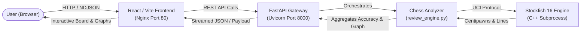
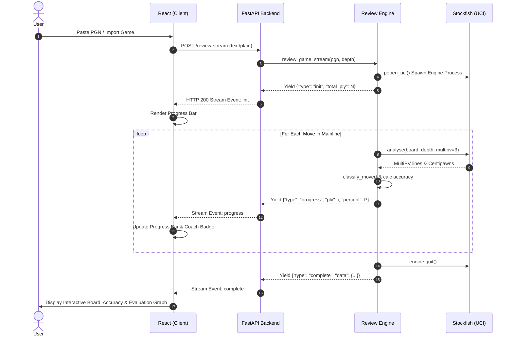
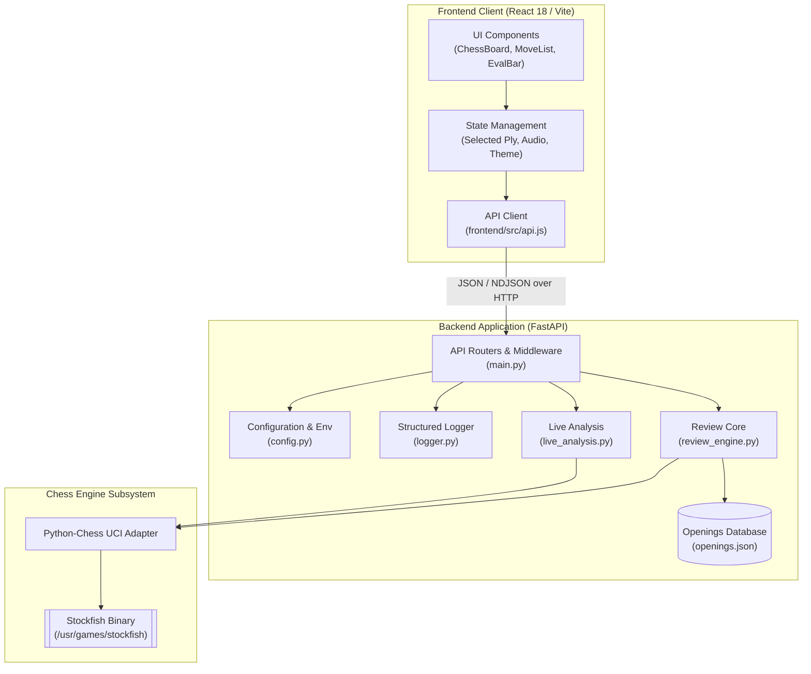
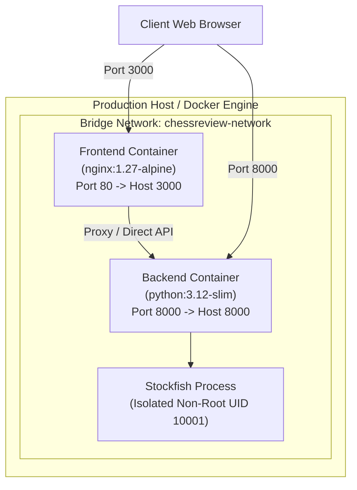
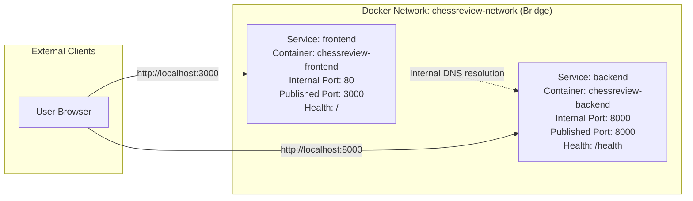

# ChessReview Architecture & System Design

This document details the system design, communication protocols, container topology, and execution flows of the **ChessReview** platform.

---

## 1. High-Level System Architecture

The following diagram illustrates the unidirectional data flow from the client browser through the containerized frontend, the FastAPI gateway, the analysis orchestrator, and the native Stockfish UCI process.



---

## 2. Sequence Diagram (Game Review Lifecycle)

This sequence diagram depicts the end-to-end lifecycle of an asynchronous streaming game review request.



---

## 3. Component Diagram



---

## 4. Deployment Topology

The application is fully containerized and can be deployed to any Docker-compatible infrastructure, VPS (DigitalOcean, AWS EC2, GCP Compute Engine), or managed container service (Railway, Render).



---

## 5. Docker Networking Diagram



---

## 6. Repository Layout

```
ChessReview/
├── .github/                      # GitHub configurations & CI/CD
│   ├── ISSUE_TEMPLATE/           # Structured issue forms
│   │   ├── bug_report.yml
│   │   ├── config.yml
│   │   └── feature_request.yml
│   ├── PULL_REQUEST_TEMPLATE.md  # Standard pull request checklist
│   └── workflows/
│       └── ci.yml                # Automated CI pipeline
├── backend/                      # FastAPI Python Application
│   ├── engine/                   # Local engine binary cache (gitignored)
│   ├── games/
│   │   └── sample.pgn            # Reference game sample
│   ├── opening_books/
│   │   └── openings.json         # ECO opening database (3,399 positions)
│   ├── __init__.py
│   ├── config.py                 # Centralized configuration & environment loader
│   ├── Dockerfile                # Production backend container build
│   ├── live_analysis.py          # Single position evaluation module
│   ├── logger.py                 # Structured logging utility
│   ├── main.py                   # FastAPI application & route definitions
│   └── review_engine.py          # Core chess analysis & classification logic
├── docs/                         # In-depth architectural & API manuals
│   ├── API.md                    # REST API reference manual
│   ├── ARCHITECTURE.md           # Mermaid system diagrams & topology
│   └── CHESS_ENGINE.md           # Heuristic math & classification matrix
├── frontend/                     # React / Vite SPA
│   ├── public/                   # Static browser assets
│   ├── src/                      # React components, styles, audio, and state
│   ├── Dockerfile                # Production Nginx multi-stage build
│   ├── nginx.conf                # Nginx SPA routing & gzip configuration
│   ├── package.json              # Frontend dependencies and build scripts
│   └── vite.config.js            # Vite build configuration
├── infra/
│   └── docker-compose.yml        # Multi-container orchestration definition
├── tests/                        # Automated test suite
│   ├── __init__.py
│   ├── conftest.py               # TestClient & mock board fixtures
│   ├── test_api.py               # REST API contract and endpoint tests
│   └── test_review_engine.py     # Move classification & accuracy unit tests
├── .dockerignore                 # Container build exclusion list
├── .editorconfig                 # Cross-editor styling rules
├── .env.example                  # Environment configuration template
├── .flake8                       # Flake8 style guide configuration
├── .gitignore                    # Master Git ignore rules
├── .pre-commit-config.yaml       # Git pre-commit hooks
├── CHANGELOG.md                  # Project version history
├── CODE_OF_CONDUCT.md            # Contributor Covenant v2.1
├── CONTRIBUTING.md               # Contribution guidelines & workflow
├── LICENSE                       # MIT Open Source License
├── Makefile                      # Developer command center
├── pyproject.toml                # Black, Ruff, isort, pytest configs
├── README.md                     # Project portfolio README
├── requirements-dev.txt          # Development, testing, and linting packages
├── requirements.txt              # Production Python dependencies
└── SECURITY.md                   # Vulnerability disclosure policy
```

